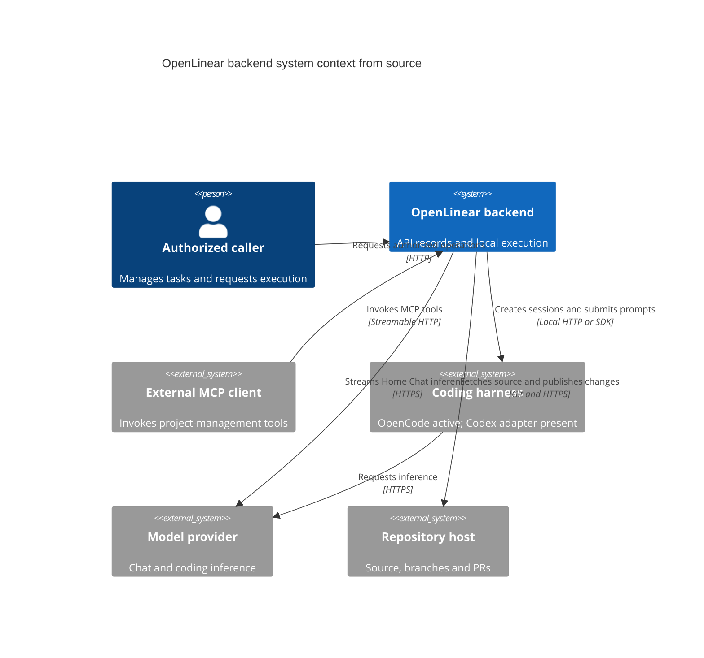
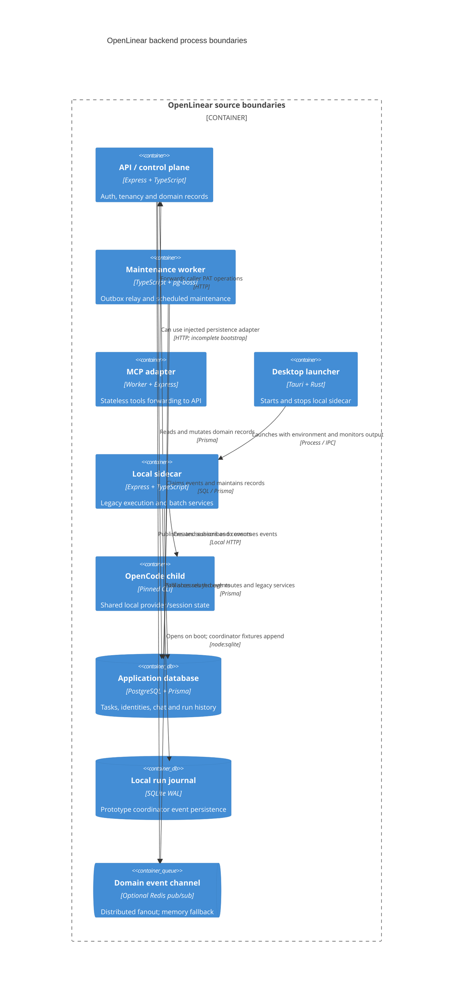

# OpenLinear backend codebase context — 2026-10-15

OpenLinear has useful API, chat, Git, and execution components, but its newer runner/coordinator design is not the normal task execution path. The September Phase 1–2 completion labels describe code presence and selected tests more confidently than the integration supports.

This document maps the checkout and reconciles the prior Desktop revamp plan. Detailed findings and delivery gates live in the [API/data](backend-review-2026-10-15/api-data.md), [execution](backend-review-2026-10-15/engine.md), [AI product](backend-review-2026-10-15/ai-product.md), [isolation](backend-review-2026-10-15/sandbox.md), [Codex research](backend-review-2026-10-15/openai.md), and [evaluation research](backend-review-2026-10-15/benchmark.md) reports. The [master backend plan](../../tasks/prd-backend-agent-platform.md) owns the delivery sequence.

## Scope and evidence

- Baseline: checked-out `dev` at `157de4e8e16580309dde04bca033647ab98b1c6a`, plus the coordinated first-tranche worktree changes made during this review.
- Source inspection verifies callers, imports, persisted fields, and missing wiring. It does not establish production configuration or prove that every source file was reviewed.
- Current local tests establish the behavior exercised by their fixtures. Older `ISSUES.md` test counts remain historical records, not current acceptance evidence.
- No paid model evaluation, production request, remote database audit, credential rotation, deployment, or cloud provisioning was performed.
- Frontend implementation and deployment/release infrastructure are excluded. Rust launcher code is included because it defines backend process, credential, and identity boundaries.
- The [validation record](backend-review-2026-10-15/validation.md) owns final commands, results, exceptions, and benchmark artifacts; totals here are intentionally not a replacement for it.

## System context

The control plane is a logical role implemented by `apps/api`; there is no `apps/controlplane` application in this checkout. Authorized callers reach API records directly or through the MCP adapter. Coding executes in a separate local process path.

## Process and package boundaries

This is a logical container map, not a deployment diagram. It deliberately shows remaining database coupling instead of drawing the intended API-only sidecar as already complete.

Shared libraries are in-process dependencies, not additional services:

| Boundary | Main sources | Actual responsibility / dependency |
| --- | --- | --- |
| API | `apps/api/src/{index,app}.ts` | Composes domain routes, auth, HTTP errors and health; owns Postgres policy |
| Worker | `apps/api/src/worker.ts`, `jobs/index.ts` | Same API codebase, different entrypoint; relay plus maintenance scheduling |
| MCP | `apps/mcp/src/{index,app}.ts`, `mcp/{server,transport}.ts` | Request-local server/transport; calls API rather than Prisma |
| Sidecar | `apps/sidecar/src/{index,app}.ts` | Loopback HTTP, execution/batches/provider/transcription/local events |
| Rust launcher | `apps/desktop/src-tauri/src/{lib,sidecar,opencode,deeplink}.rs` | Child lifecycle, environment construction, detection and callback handoff |
| Database library | `packages/db/src/{client,crypto,index}.ts` | Lazy Prisma adapter-pg client, generated types and encryption helpers |
| Domain helpers | `packages/api-core/src/` | Scope vocabulary, cache/pagination/envelope/error/logger/telemetry helpers |
| HTTP client | `packages/api-client/src/index.ts` | Manually maintained API methods; many request/result types remain `unknown` |
| Execution core | `packages/execution-core/src/` | Pure batch rules, prompts, normalized events/reducer and fake runner |
| Telemetry | `packages/telemetry/src/index.ts` | In-memory counters/histograms; exporter and route wiring remain incomplete |
| Other shared packages | `packages/{types,openlinear,openlinear-cli}/` | Shared DTO/utilities and installer; no separate execution control plane |

Sidecar still depends on `@openlinear/api` and `@openlinear/db`. Importing API auth/ownership also imports database policy into a user-machine process. MCP re-exports the shared client by a relative source import, while its tool declarations remain separately maintained.

The current manifests/lockfile are the dependency baseline, not “latest” versions: Prisma 7.x, OpenCode SDK 1.18.x, Codex SDK 0.147.0, API/sidecar Zod 3, MCP Zod 4 and MCP 2.0 alpha packages. The proposed phase-wide SDK upgrades must be treated as contract migrations, not copied from old version recommendations.

## Data and authority ownership

| State | Current owner / storage | Important boundary |
| --- | --- | --- |
| Workspace/team/project grants | API; `WorkspaceMember`, `TeamMember`, `ProjectAccess` | Explicit project deny must override every read, nested payload, mutation and event |
| Tasks and issue numbering | API/Postgres; `Task`, `Team.nextIssueNumber` | Counter allocation is transactional; broader relationships are not yet enforced structurally |
| Labels/phases | API/Postgres; `Label`, `TaskLabel` | Phase is a label naming convention, not a sprint/milestone/dependency model |
| JWT/refresh/session/PAT identity | API/Postgres; `Session`, `PersonalAccessToken`, `Identity` | Sessionless auth is a test/compatibility escape hatch; workspace-bound PAT propagation is missing |
| SSE tickets and challenges | API/Postgres; `SseTicket`, `TwoFactorChallenge` | Opaque rows exist, but consumption and session binding need concurrency hardening |
| Chat transcript/tool records | API/Postgres; `ChatSession`, `ChatMessage`, `ChatToolCall` | Persistent transcript exists; durable turn lease/operation commitment does not |
| Run history and usage | Postgres `AgentRun`, `AgentRunEvent`; legacy sidecar writes | Five usage fields exist; complete invocation accounting and immutable event ingest do not |
| Domain events | Postgres `DomainEvent`, then bus/SSE | Most writes are post-commit broadcasts; audience arrays are not sufficient authorization |
| Local journal | Sidecar SQLite `runs`, `run_events` | Durable local append exists for coordinator; API backlog/ack cursor is memory-only |
| Live execution and batches | Sidecar maps/sets | Active routes depend on process memory, not a durable attempt/queue/completion lease |
| Workspaces/Git mirrors | Sidecar filesystem | Worktree is a Git isolation mechanism, not an OS or tenant security boundary |
| OpenCode auth/session state | One owned child plus provider files | `getClientForUser` does not create independent provider ownership per user |
| Attachments | API database metadata plus local blob implementation | Scan fields exist; shared object storage/text-extraction lifecycle is incomplete |
| Launcher settings/PID | Tauri `settings.json` and `sidecar.pid` | General settings store is not the proposed keychain; numeric PID alone is not process identity |

The schema still permits `Project.workspaceId`, `Task.projectId`, and `Task.workspaceId` to be null. Current task writers omit or fail to maintain denormalized workspace identity. Parent task linkage is hierarchy only; there is no durable executable plan DAG, acceptance-evidence model, product AI schedule, or trusted-memory provenance model.

## Active request paths

### Domain API and real-time

`apps/api/src/index.ts` validates startup settings, installs telemetry hooks, creates the Express app and starts real-time delivery. `app.ts` mounts roughly thirty route files; it does not mount an execution runner.

Bearer authentication flows through `middleware/auth.ts` into session/PAT validation and `tenancy/context.ts`. Scoped list predicates exist in `tenancy/scopes.ts`; concrete-resource checks still delegate to `services/ownership.ts` and `services/workspaces.ts`.

Task routes call `services/tasks.ts`; the HTTP task list currently uses page/offset/count, while a separate cursor-facing service is used by other callers. Task create/bulk paths are shared more than before, but update and relation-sync variants remain divergent.

Most mutations call `sse.ts` after their domain write. That asynchronously persists `DomainEvent`, publishes through optional Redis or local fallback, and feeds `events/hub.ts`. The API and worker can both run the relay. `/api/events` serves domain replay and separate run-journal replay using different cursor formats.

Sources: `apps/api/src/{app,sse,registry}.ts`, `middleware/auth.ts`, `services/tasks.ts`, `tenancy/`, `events/`, `routes/events.ts`, `routes/agent-runs.ts`.

### Single-task local execution

`POST /api/tasks/:id/execute` on the sidecar calls API auth/ownership, then `services/execution/lifecycle.ts`. It resolves task/settings/SCM credentials, prepares a checkout, directly creates an OpenCode session, subscribes, and uses `promptAsync`.

The first tranche now propagates the remote provider's actual `WorkspaceHandle`, branch and path into branch creation, the directory-bound client, session and execution state. Setup failure releases owned remote checkouts; it preserves a user's local checkout.

The active path still records requested runner identity after choosing OpenCode directly. `Task.agent` / `Project.defaultAgent` therefore do not prove that normal routes dispatch Codex. Legacy `events.ts`, `event-stream-processor.ts`, `state.ts`, `agent-run.ts` and Git/PR helpers own finalization and terminal persistence.

Sources: `apps/sidecar/src/routes/execution.ts`, `services/execution/{lifecycle,events,event-stream-processor,state,agent-run,git}.ts`, `services/opencode.ts`.

### Batch execution

`routes/batches.ts` calls `services/batch/orchestrator.ts`, reads Prisma directly, creates in-memory batch state and uses legacy worktree/session management. Parallel, queue and combined modes have different orchestration/completion paths.

`services/session-manager.ts` handles legacy batch events; it is distinct from `engine/session-manager.ts`. Batch completion stages commits, merges, pushes and opens a PR through `services/batch/completion.ts`. These are real paths, with unresolved repository-selection, cancellation, concurrency and publish-failure semantics.

Sources: `apps/sidecar/src/routes/batches.ts`, `services/batch/{orchestrator,completion,shared}.ts`, `services/{session-manager,worktree}.ts`, `packages/execution-core/src/batch/`.

### Home Chat, planning and MCP

Home Chat routes invoke `services/chat.ts`: validate owned session/scope, persist the user message, build a capped transcript, stream the hand-written `ChatLLMClient`, dispatch tools, persist results and stream text/tool updates. The title helper performs additional model work.

The chat catalogue has withheld privilege tools and persisted calls, but has no durable turn lease, effect-aware approval protocol, complete usage ledger or cancellation-safe write commitment. Project setup creates flat tasks/labels/date updates; it is not a validated executable plan.

MCP accepts PAT-bearing `/mcp` POSTs and constructs a fresh transport/server. Twelve tools are registered across workspace, project, team, label, phase, issue and bulk-plan modules; the old “8 tools” context is stale. Bulk plan creates records through several API calls and can return partial phase errors.

Sources: `apps/api/src/routes/chat.ts`, `services/{chat,project-plan}.ts`, `services/chat-tools/`, `lib/chat-llm.ts`; `apps/mcp/src/mcp/{transport,server}.ts`, `mcp/tools/`.

## Present but not integrated into those paths

| Component | Evidence of presence | Integration gap |
| --- | --- | --- |
| `RunCoordinator` | `apps/sidecar/src/engine/run-coordinator.ts` | No normal execute/batch route constructs it; current callers are test/benchmark fixtures |
| Normalized `SessionManager` | `apps/sidecar/src/engine/session-manager.ts` | Only some reducer actions are interpreted; EOF/terminal/resource release semantics need completion |
| OpenCode/Codex runners | `apps/sidecar/src/runners/` | Adapter fixes are tested independently; route selection remains legacy |
| Budget/cancel helpers | `apps/sidecar/src/engine/{watchdogs,cancel}.ts` | Helpers do not establish active-route budget checkpoint or descendant reaping |
| SQLite journal | `apps/sidecar/src/journal/sqlite.ts` | Opened during boot recovery; legacy run starts/events are not attached to it |
| Recovery matrix | `services/execution/recovery.ts` | RESUME counts decisions; salvage changes status; no full event reattachment/completion resumption |
| API persistence seam | `apps/sidecar/src/persistence/store.ts` | No production initializer calls `setDefaultApiClient`; many routes/services still use Prisma |
| Local execution SSE | `apps/sidecar/src/sse/local.ts` | Independent JWT verifier/client registry; replay branch is a comment and legacy broadcasters are separate |
| Feature modules | `apps/api/src/modules/*/index.ts` | Re-export facades rather than routes/schema/service/repository/event aggregate boundaries |
| Telemetry hooks | `packages/telemetry/src/index.ts` | No OTLP implementation, missing route instrumentation and unbounded retained samples |

API-only sidecar boot is contradictory: `persistence/boot.ts` rejects `DATABASE_URL` except explicit loopback test mode; Rust `build_sidecar_env` still supplies database and JWT/encryption settings; without DB mode, store/auth/ownership paths are not fully initialized for API transport.

Boot recovery is invoked before provider initialization, and the boot journal is not retained as the active execution journal. `recoverActiveBatches` returns an empty result. Opening the database or passing a liveness check is not evidence that restart recovery works.

There is no `packages/ai-core`, `packages/sandbox`, Claude Code runner, authenticated device/run capability handshake, private credential broker, or actual OS sandbox provider in the reviewed source tree.

## Disposition of the prior Desktop phases

The source plan is the user's `Open Linear Revamp Plan/03-phases/PHASE-{0..7}-*.md`, supplemented by A1–A5 and the code reviews. Its dated dependency/pricing/latency assumptions require revalidation. Calendar durations are not acceptance evidence.

| Prior phase | Backend disposition | Keep / complete | Excluded from this backend review |
| --- | --- | --- | --- |
| 0 — Stop the bleeding | Significant hotfixes present; closure incomplete | Auth guards, test-DB guard, path/Git/env hardening, accurate tool selectors and source-to-runtime checks | Frontend fixes; live rotation/history purge/deploy verification |
| 1 — Platform foundations | Partial structural implementation | One tenancy policy, atomic commands/idempotency/outbox, durable jobs, typed contracts and measurable queries | Cloud services, deployment gates, release/backup provisioning |
| 2 — Execution engine v2 | Components plus legacy production execution | Repair coordinator effects/admission/journal/completion, API-only sidecar and route migration | Paid provider runs, cloud execution; frontend presentation |
| 3 — Sandboxing/trust | Mostly absent; prerequisites still unsafe | Local supervisor/provider capabilities, credential mediation, trust/approval policy and deterministic isolation corpus | Cloud sandbox provisioning; trust UI and release rollout |
| 4 — AI platform | Current chat exists; proposed platform absent | Incremental provider seam, turn durability, metering/context/artifacts/policy/memory/evals; third-runner contracts | Cost/context UI; unverified promised SDK versions and savings |
| 5 — Frontend revamp | Frontend phase excluded | Backend event/cursor/capability/approval/usage contracts are dependencies only | UI packages, TanStack Query, virtualization, visual/keyboard work, updater/release |
| 6 — Cloud execution/scale | Cloud implementation excluded; backend prerequisites incomplete | Local replay/lease/queue/retention contracts and MCP parity can be designed/tested without deployment | Cloud jobs, horizontal rollout, managed secrets, restore/release operations |
| 7 — Product AI | Basic chat/MCP record creation only | Plan DAG/acceptance evidence, bounded verification/review/repair, provenance memory and local schedules | Public sharing, external messages/reviews, cloud autonomous execution |

Phase 0's hardcoded-secret removal, default-deny orphan reads, session revocation, hardened upload/download routes, `promptAsync`, secret-aware logs and environment allowlist are useful foundations. New audits still find missing workspace PAT constraints, broader event authorization, Git configuration/credential boundaries and no enforced host read boundary.

Phase 1's scoped helpers, opaque tickets/challenges, auth refresh schema, outbox tables, pg-boss dependency, module directories, API packages and audit catalog are present. The “code complete” label does not cover atomic outbox claims, current grants in SSE, exhaustive actual-route matrix, request-hash idempotency or the promised NOT NULL ownership invariants.

Phase 2's run event schema, five usage fields, journal, runners, worktree provider, reducer and tests are present. The “Execution Engine v2 done” label does not cover the normal route, crash recovery, API-only desktop bootstrap, multi-hour soak, batch completion integrity or true model/runner dispatch.

Phase 3 must not infer secure execution from Phase 0 allowlists, `cwd`, file modes, OpenCode permissions or Codex `workspace-write`. Test filesystem, process, credential and egress boundaries directly on each selected platform before increasing autonomy.

Phases 4/7 are product capabilities to build after trustworthy operations. Keep current chat/provider seams and phase-label compatibility; do not add a second independent executor or treat parent-child tasks as dependency edges.

Phase 6's MCP improvements belong in backend contracts where independently useful. A runtime SDK, an agent SDK, app-server, a managed agent API and an OS sandbox are different layers; research does not make any of them integrated or production-ready here.

## First-tranche changes and their evidence

The review implemented narrow fixes instead of claiming whole-phase closure. Tests use local fixtures, disposable repositories and loopback databases; model/GitHub boundaries are mocked where appropriate.

| Change | Files / test evidence | What it establishes |
| --- | --- | --- |
| Run replay and ingest permissions | `apps/api/src/routes/{events,agent-runs}.ts`, `__tests__/events.access.test.ts` | Replay rejects unrelated/denied users before headers; view-only users cannot alter progress |
| Exact archive selectors | `apps/api/src/services/{tasks,chat-tools/domain}.ts`, `__tests__/tasks.archive-selectors.test.ts` | Malformed/blank/empty selectors cannot broaden archive to the whole project |
| Acquired workspace propagation | Sidecar `services/execution/{git,lifecycle}.ts`, `lifecycle-worktree.test.ts` | Actual remote path/branch is used and failed setup releases owned checkout |
| Workspace provider references/safety | `workspace/local-worktree.ts`, `local-worktree.test.ts` | Fresh branch/tag namespaces, protected existing attempts, path/symlink/release ownership checks and credential-scoped materialization |
| OpenCode event ownership | `runners/opencode/index.ts`, `index.test.ts` | Direct/nested session ownership is checked before decoding; adapter fixtures provide regression evidence |
| Codex contract normalization | `runners/codex/{index.ts,index.test.ts}` | Fatal/status/file/message/usage/model/cancellation contracts corrected in SDK-typed adapter fixtures |
| Offline benchmark | `scripts/latency-bench.{mjs,ts}`, `latency-300mb.mjs`, provider tests | Real synthetic Git + SQLite + coordinator/fake-runner phases now produce raw measured samples |

Final API, sidecar and execution-core suites passed; the two existing API skips are explained in the validation record. API, sidecar, execution-core, MCP and Desktop UI compatibility typechecks passed. The final [validation ledger](backend-review-2026-10-15/validation.md) provides totals, commands and exact fixture boundaries; the disposable local test container was removed afterward.

The small benchmark completed 30 measured trials (5 cold, 25 warm) over 2 MB/8 files. The 300 MiB fixture completed 4 trials (1 cold, 3 warm). These measure local worktree/journal/coordinator overhead to a scripted fake delta; cold means empty app mirror, not flushed OS cache. Small tail estimates are descriptive.

These tests do not establish paid model quality, task-to-PR completion, operating-system isolation, API transport recovery, real provider cancellation/reaping, multi-replica SSE or public benchmark superiority. `scripts/soak.mjs` remains metadata-only; six-hour/2M-token acceptance is pending.

## Backend blockers that determine delivery order

1. **Ownership must reach every transport.** Close PAT workspace propagation, nested/reporting/comment scope drift, domain/live SSE project deny and private-chat audiences before treating tenancy as structural.
2. **Sidecar identity and persistence must agree.** Establish authenticated request/run-bound API access and desktop bootstrap; remove direct Prisma and shared JWT-secret requirements from active sidecar routes.
3. **One lifecycle must own attempts.** Repair the coordinator's effect interpreter, immutable event journal, external session identity, admission and resumable completion before routing single and batch tasks through it.
4. **Publication must be truthful.** A local commit, transport timeout, salvage, pushed branch and opened PR need distinct durable outcomes. Retain incomplete artifacts instead of marking push failure as completed.
5. **Retries must not duplicate effects.** Mutation, request digest, idempotency claim/result, audit/event and ambiguous tool-write reconciliation need a consistent commitment boundary.
6. **Isolation must be implemented.** Separate supervisor/agent credentials, private runtime state, protected Git metadata, constrained egress and verified descendant cleanup; no silent trusted-host fallback.
7. **Chat/planning needs durable contracts.** Turn leases, provider terminal/usage parsing, artifacts, exact approvals and plan/evidence graphs precede bounded PM orchestration.
8. **Latency needs a matching workload.** Add bounded telemetry and API/query fixtures; active HTTP board uses offset/count and createdAt while older proposed indexes target updatedAt. Usage and payload queries remain amplified.
9. **Acceptance scripts must run the behavior claimed.** Current offline measurements are a starting tool; restart/cancel/concurrency/security/provider/held-out quality suites are distinct remaining gates.

The useful dependency chain is: current correctness → unified auth/atomic domain operations → actual coordinator/journal/sidecar integration → local sandbox/credentials → durable AI/context/policy → plan/verification/review → provenance memory/local schedules. Measurement and fast regression tests run alongside each slice.

## Working from this context

- Use the [six detailed reports](backend-review-2026-10-15/) for exact source findings, proposed work packages and acceptance cases; this map avoids duplicating those specifications.
- Use `AGENTS.md` and `ISSUES.md` for repository protocol and historical context, but verify claimed completion at the current caller and test boundary.
- Preserve existing route/client exports while extracting aggregate services and adding cursor, event, run and plan contracts. Source existence alone is not a reason to delete working legacy paths.
- Backfill and validate tenant/relationship data before tightening nullable constraints. An additive field or index file is not proof that a production migration was applied.
- Record requested versus effective runner/model/policy and unknown billing/observability coverage. Never turn absent usage into an asserted zero-cost or complete run.
- Reconcile this document when production route wiring, persistence ownership, isolation, or accepted phase status changes; keep historical audit findings distinguishable from repaired behavior.
