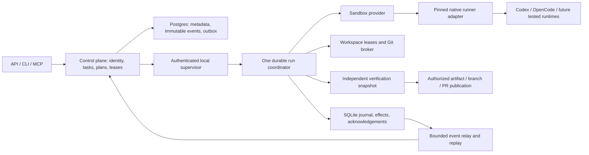

# OpenLinear backend master plan

Updated: 2026-10-15. Baseline: cloned `dev` at `157de4e`, plus the explicitly listed local first-tranche changes. Status: **programme planned; first repairs implemented and locally validated; major engine integration remains pending**.

This is the backend replacement roadmap for the Desktop “Open Linear Revamp Plan.” Keep that folder as historical research. Use this document, the contracts, the source audits, and the validation ledger as the current execution order. A checked box or an existing class does not establish production integration.

## 1. Product objective and scope

Build a local-first agent execution product that turns a scoped task into an independently verified, recoverable code artifact. It must explain what ran, where it ran, which authority it used, what changed, what passed, what failed, and what it cost. Optimize successful, policy-compliant task completion per unit of time and cost; token speed alone is insufficient.

The ambition is a leading coding-agent backend. Superiority over Codex, Claude Code or Devin is an **experimental goal**, not an established result. The comparison must name model, native harness, runner version, environment, dataset, time and spend limits. OpenLinear using Codex underneath cannot attribute all model quality to its own orchestration.

Included: API/data correctness, task creation and planning, agent execution, SDK integration, admission and batching, local workspaces, sandboxing, credentials, context, tools, cancellation/recovery, verification, publication semantics, usage, backend integrations, performance and evaluation.

Excluded from implementation: frontend components/design/state management, deployment, infrastructure provisioning, paid evaluation runs, and migrating live data. Backend contract changes needed by a future client remain included. No cloud service is a prerequisite for the initial deterministic work.

Companion files:

- [Codebase context and old-plan status](../docs/reports/backend-codebase-context-2026-10-15.md).
- [Backend product contracts](../docs/plans/backend-product-contracts.md).
- [Validation and first-tranche results](../docs/reports/backend-review-2026-10-15/validation.md).
- [Engine audit](../docs/reports/backend-review-2026-10-15/engine.md), [API/data audit](../docs/reports/backend-review-2026-10-15/api-data.md), [AI/product audit](../docs/reports/backend-review-2026-10-15/ai-product.md).
- [Sandbox threat model and acceptance corpus](../docs/reports/backend-review-2026-10-15/sandbox.md).
- [OpenAI integration research](../docs/reports/backend-review-2026-10-15/openai.md), [benchmark protocol and research](../docs/reports/backend-review-2026-10-15/benchmark.md).
- [Frontend work pending](</Users/sriharsha/Downloads/frontend work pending.md>).
- [Cloud services pending](</Users/sriharsha/Downloads/OpenLinear cloud services pending.md>).

## 2. What exists, and what is actually missing

The repository has useful foundations: Express/Zod APIs, Postgres/Prisma models, existing ownership helpers, single and batch execution, Git helpers, a pure event reducer, runner prototypes, SQLite journaling, an API client, outbox models and tests. Preserve working behavior and consolidate it.

However, the normal execute routes still start OpenCode directly. They do not instantiate the new RunCoordinator or route task selection through the normalized runner adapters. The journal is not the durable source for ordinary runs. “API-only” persistence has no production initialization of its client while routes and batch code still depend on Prisma. Recovery largely selects a decision without performing reattachment or resumable publication.

Critical verified gaps include:

1. Remote single-task setup discarded the acquired worktree path. This is repaired in the first tranche with real-Git composition tests.
2. Run replay lacked resource authorization; progress accepted view-only users. These narrow paths are repaired; broader project-deny event routing and PAT workspace binding remain open.
3. Empty archive selectors could broaden into project-wide mutation. This is repaired at the shared service boundary.
4. Batch execution can mix repositories, exceed configured concurrency, lose cancellation state and report success after publication failure. These remain high priority.
5. Runner selection can label OpenCode work as another provider. Correcting an unused adapter does not correct route selection.
6. The prototype coordinator leaks/loses reservations on some paths and its effect interpreter ignores important reducer actions. It must pass parity gates before route migration.
7. Event mirroring/outbox and replay are not durable, immutable, consistently scoped or bounded end to end.
8. OpenCode executes on the host with shared state; worktrees and SDK permission flags are not an OS isolation boundary.
9. Private credentials, local capabilities, Git publication and agent tool execution need separate authority.
10. Old latency/soak scripts printed configuration. The first tranche replaces latency placeholders with a real offline microbenchmark; the soak programme remains pending.

The older phase numbering is misleading as an implementation checklist: Phase 0 has code but unresolved operational evidence; Phases 1–2 contain substantial scaffolding with incomplete production wiring; Phase 3 sandbox and Phase 4 AI infrastructure remain largely pending. Phase 5 frontend and Phase 6 deployment/cloud work are outside this roadmap. Relevant Phase 7 backend product features are reorganized below.

## 3. Nonnegotiable invariants

- A task is intent. An attempt is one execution with an immutable task/repository/policy snapshot. A provider session is neither identity.
- Every read, write, tool call, event, artifact and callback carries an authenticated principal and resource scope. Knowing a UUID gives no authority.
- Admission reserves capacity before asynchronous setup. Pending work counts toward limits. Cancellation of queued/preparing work is real.
- Each attempt owns its workspace and process lifetime. User checkouts, another attempt's worktree and shared Git metadata cannot be mutated by accident.
- Only one active coordinator/finalizer holds a valid lease/fencing token for an attempt. The broker rejects new effects from expired workers; already-dispatched external requests are reconciled rather than assumed rolled back.
- State transitions, events and outstanding effects are durable before acceptance is acknowledged. External effects use idempotent reconciliation; do not promise exactly-once networking.
- A lost stream is not success. A diff is not success. A model saying “done” is not success. A push failure is not success.
- Acceptance checks and grading inputs are captured before execution and protected from agent mutation. Evidence names the evaluated commit and environment.
- A sandbox is selected by enforced capabilities, verified on the actual platform. Missing isolation fails closed unless an explicit, recorded trusted-host grant applies.
- Secrets stay outside untrusted tools. Redaction is a second boundary, not credential isolation.
- Every queue, event buffer, transcript, artifact store, metric and retry loop has a bound, retention policy and failure behavior.
- Provider capabilities and usage must be truthful. Unknown prices remain unknown; cached/reasoning tokens are not counted twice.
- Correctness, policy and isolation gates cannot be traded away for a faster benchmark.
- Existing API consumers get additive compatibility or an explicit version transition; no silent bulk payload/cursor/status changes.

## 4. Target architecture

Keep a modular TypeScript backend and local supervisor. Do not begin with a language rewrite, a microservice split or an always-on swarm. Those require profiling or evaluation evidence.

### Control plane

Own identity, membership, access policy, repository binding, task/plan revisions, execution authorization, device registration, run leases, externally visible run summaries, artifact metadata and usage aggregation. Postgres is authoritative for shared metadata. Every mutating API operation includes request identity, validated payload, resource authorization and an explicit transaction boundary.

A durable outbox is written in the **same database transaction** as the domain mutation. A delivery worker claims a time-bounded lease with fencing/attempt metadata, publishes, then records acknowledgement. Delivery is at least once; consumers deduplicate event IDs. No swallowed publish error is recorded as delivered.

### Local supervisor and execution service

The supervisor owns credentials, sandbox handles, process identities and local durable state. It authenticates the API/device handshake and local callers; it does not share the cloud JWT signing key or a production database URL with the agent process.

Use request/run-scoped API clients and capability tokens. No process-global mutable user bearer token. Remove Prisma and imported cloud authentication internals from the production API-only sidecar path after equivalent API contracts and tests exist.

One run service handles single tasks, plan members and combined batches. Scheduling calls this service; it does not implement another execution engine. Use an exhaustive reducer/effect interpreter, explicit asynchronous start acknowledgement, immutable events, scoped subscriptions and a terminal result contract.

### Storage ownership

| Record | Authoritative owner | Required properties |
|---|---|---|
| TaskSpec / PlanRevision | API/Postgres | Immutable revisions; scope, dependency DAG, acceptance manifest; explicit supersession |
| RunAttempt / ExecutionLease | API/Postgres plus local journal identity | Unique attempt, task revision, device, repository/base SHA, runner/model, policy hash, fence, terminal result |
| Local transition / pending effect | SQLite | Atomic append + state + effect intent; recoverable after SIGKILL |
| Provider session reference | Local journal | Actual upstream ID, runtime/state directory, last observed status/cursor; never a synthesized ID |
| Domain/run event | Postgres and local journal by contract | Immutable ID/payload hash, ordered per stream, current authorization, retention/cursor expiry |
| Verification / publication artifact | Artifact store + metadata | Content hash, base/head SHA, verifier revision, results, redacted logs, retention |
| UsageEntry | API ledger, raw receipt locally | Provider event identity, normalized categories, source semantics, estimate/invoice basis |
| TrustGrant / Approval | API policy + local validated receipt | Actor, scope, exact effect digest, expiry, one-time consumption, revocation |
| MemoryEntry / repository index | Scoped context service | Provenance, repo revision, tenant boundary, expiry, promotion/retraction history |

Schema names are proposed contracts, not a mandate to create all tables immediately. Add only the next slice's entities; keep transport and domain types independent of Prisma.

### Execution state and effects

Proposed lifecycle: queued → preparing → running ↔ awaiting_approval / compacting → verifying → publishing → succeeded. Alternatives include cancelled, failed, budget_exhausted, interrupted, salvaged and recovery_required. Store termination reason independently of user-facing task status.

Persist an event envelope with eventId, schemaVersion, runId, sequence, observedAt, causationId, resource binding, kind and validated payload. Public streaming uses one documented cursor scheme with paginated replay, a replay/live barrier, deduplication and an explicit expired-cursor response. Keep domain-feed and run-log cursors distinct and typed if they are separate streams.

Effects have deterministic keys such as runId + stage + artifact digest. Record intent, execute, reconcile outcome, acknowledge. The broker checks the current fence and consumes a one-time effect authorization immediately before dispatch. For push or PR creation, check the actual remote branch/PR after an ambiguous response. A stale fence cannot start a new effect. Cancellation prevents new dispatch; a request already accepted remotely may land after cancellation and must be reported/reconciled. A cancelled attempt cannot quietly become succeeded after an await, and cancellation does not promise external rollback.

### Completion and independent verification

Completion stages: freeze output → reap/quiesce agent processes → validate path/diff/secret policy → create a broker-owned candidate commit without publishing → execute the trusted acceptance manifest in a clean checkout of that exact commit → persist evidence → authorize publication → push that same verified commit/reconcile PR → persist terminal outcome → release or retain workspace. Any subsequent content change invalidates verification and requires a new candidate and evidence.

W11 starts with a minimal sealed acceptance manifest captured from the task revision. It does not wait for W17's full plan compiler; W17 later produces the same versioned contract.

Verification commands themselves can execute repository code; run them within a verified sandbox. The agent cannot rewrite hidden assertions, grading scripts or acceptance policy. Preserve both declared checks and newly discovered tests; passing only agent-authored tests is weaker evidence.

A local artifact can be a valid configured outcome without a PR. If the task requires a remote PR, an upload failure produces a retained, retryable publication state. Salvage artifacts are explicitly incomplete; they never automatically mark the task done.

## 5. Runner and OpenAI strategy

Start with exact installed contracts: Codex SDK 0.147.0, OpenCode SDK 1.18.30 and OpenAI SDK 6.22.0 in this lockfile. These are baseline versions, not “latest” recommendations. Pin SDK, binary and fixture/protocol versions together; evaluate upgrades independently.

| Surface | Role in this project | Gate |
|---|---|---|
| Codex TypeScript SDK | First native local coding baseline; existing adapter retained and corrected | Typed events, actual thread ID, model selection, abort signal, errors, usage and runtime binary smoke test |
| OpenCode HTTP/SDK | Existing production runtime during migration; one authenticated session demultiplexer per isolated backend context | Scope before decode; subscription readiness; explicit status reconciliation; no global user fallback |
| Codex app-server | Optional later adapter for interactive approvals, steering, explicit compaction/history/fork operations | A demonstrated product need plus pinned protocol and reconnect/cancellation fixtures; no dual ownership of one session |
| Responses + Agents SDK | Structured planning, task refinement, scoped tools and review where application-owned orchestration is useful | Effect-aware tools, durable turn state, budgets, schema validation and independent evaluation |
| Managed Agents API | Optional cloud execution/harness adapter | Account/API availability, data/cost/isolation contract and separate cloud decision; never blocks local engine |
| Claude Agent SDK / Devin CLI | Named benchmark baselines; future product adapters only if needed | Capability conformance, licensing/auth/runtime checks, spend accounting and sandbox compatibility |

The Codex SDK already operates a coding harness. Replacing it with a new custom shell loop is an experiment, not an assumed improvement. Conversely, a thread ID alone does not preserve files or runtime state. Persist native session data with the run workspace and verify what resume actually does.

Required Runner contract: prepare/preflight; start with validated model, policy and cancellation; subscription ready; submit once; inspect; attach/resume without implicit duplicate prompt; stream normalized events; interrupt/abort with explicit semantics; close. Unsupported operations return a typed unsupported result rather than a no-op.

The initial Codex patch makes abort-backed interruption explicit; it does not claim graceful process-tree termination or interactive approval support. The OpenCode patch fixes prototype adapter session filtering; legacy consumers must still converge onto the tested path.

Use one authoritative context strategy for each API integration. Do not combine full local history replay with provider-managed conversation state accidentally. Preserve opaque compaction state according to its provider contract. Stable prompt/tool prefixes can improve caching; measure actual cache categories and success rather than assuming reuse.

Sources and date-specific caveats are in the [OpenAI evidence register](../docs/reports/backend-review-2026-10-15/openai.md), including [pinned SDK source](https://github.com/openai/codex/tree/rust-v0.147.0/sdk/typescript), [SDK documentation](https://learn.chatgpt.com/docs/codex-sdk), and [Agents SDK guidance](https://developers.openai.com/api/docs/guides/agents/sdk). Research is current to the review date; validate availability at implementation time.

## 6. Sandbox, Git and credentials

Implement SandboxProvider as a supervisor boundary, with platform-specific implementations behind one validated policy. Required dimensions: read/write roots, private HOME/config/tmp, network egress, credential exposure, process lifetime and resource ceilings. A filesystem permission setting alone is not the contract.

First implement Linux and macOS with real enforcement tests. Evaluate Windows against current capabilities and return unavailable where guarantees cannot be met. Do not translate “library supports Windows alpha” into “our Windows sandbox is secure.” Provider selection is a capability test, not an OS-name switch.

Trusted-host mode, if retained for migration, requires an explicit per-project grant with actor, revision, reason, expiry and audit. It cannot be a silent fallback for unsupported isolation. Discovery/preflight may run without executing untrusted code.

For the first isolated execution profile, prefer a dissociated snapshot with protected Git metadata. Shared mirror/object-cache optimizations come after cross-run poisoning/read tests. Mirror identity must include normalized remote identity and trust/credential boundary; owner/name alone is insufficient. Lock all mutations and coordinate across processes, not only one JavaScript map.

Host Git brokerage gets a short-lived operation-specific credential. Reset inherited credential helpers/global configuration, reject unsafe filters/hooks/remotes, isolate environment and restrict the repository/ref/effect. Avoid token-bearing URLs/argv and shared auth stores. A same-user 0600 helper file is not a credential boundary against untrusted same-user code.

An authenticated narrow inference broker may supply provider access without exposing the key. Restrict host, port, route/method and header injection; never substitute credentials into arbitrary model-generated bodies. Credentials cannot authorize sidecar APIs, Git pushes or unrelated provider accounts.

Maintain a deterministic fake-secret attack corpus covering filesystem/symlink/hardlink, Git config/filter/alternate, env/process, Unix sockets/metadata/IPv6/redirects, cross-session events, forked descendants, revoked grants and resource exhaustion. Full details and provider contract are in the [sandbox report](../docs/reports/backend-review-2026-10-15/sandbox.md). No cloud provisioning is included.

## 7. Latency and resource programme

Instrument before optimizing. Separate admission/API latency, queueing, authorization, repository refresh, checkout, sandbox preflight/launch, SDK session readiness, prompt acceptance, first provider output, verification and publication. Report end-to-end task-to-verified-artifact time alongside each component.

Proposed initial budgets below are **acceptance targets to calibrate on a declared reference machine**, not achieved product SLAs:

| Metric | Initial target | Measurement contract |
|---|---|---|
| Execute acceptance | p95 ≤ 200 ms server time | Authorized durable queued acknowledgement; excludes queue execution, includes lease/idempotency |
| Warm local preparation | p95 ≤ 1 s; investigate 300 MiB regressions above 10% | Fixed manifest, Git cache state and concurrency=1; exclude provider/network and report sandbox separately |
| Warm execute-to-first mocked event | p95 ≤ 2.7 s; CI allowance ≤ 3 s | Full HTTP → coordinator → sandbox fixture → journal path after integration; current microbench is narrower |
| Scoped list/read API | p95 ≤ 150 ms at declared dataset/concurrency | 100k tasks across scoped tenants; query plans, connection pool, loop lag and cold/warm disclosed |
| Durable event append/fanout | p95 ≤ 100 ms local; relay measured separately | Bounded batch and payload sizes, no lost acknowledged event |
| Cancellation | accepted ≤ 200 ms; reap ≤ 5 s where provider contract permits | All lifecycle stages; no new effect dispatch after fence; reconcile already-dispatched effects and report cleanup lag |
| Recovery | local reconciliation starts ≤ 10 s after dependencies ready | Actual process restart, no duplicated prompt/publish, explicit unreachable outcomes |
| Six-hour soak | no unbounded positive resource growth | Wall-clock run plus accelerated logical test; record RSS slope, journal/WAL, disk, buffers, descendants |
| Reliability | zero invariant/policy failures in deterministic release corpus | Failures cannot be hidden by aggregate latency or task-success averages |

Choose dataset cardinalities for small/medium/large tenants and skewed projects; include permission-denied queries and contended repositories. Use monotonic timings, raw samples, p50/p95/p99, sample count and CPU/disk/cache metadata. A p99 from a few trials is descriptive only.

Prioritized optimization sequence:

1. Correctness and phase traces; bounded histograms/cardinality instead of arrays retaining every observation.
2. Remove avoidable API round trips using scoped execution snapshots and aligned bulk DTOs. Batch database inserts/outbox writes inside proper transactions.
3. Shape SQL to real predicates/order. Measure EXPLAIN (ANALYZE, BUFFERS) locally; cursor pagination and narrow projections; aggregate usage in SQL. Correct the old manual index script's table mismatch before considering it evidence.
4. Bound/reduce repeated auth and lastUsedAt writes without delaying revocation. Use explicit cache keys/invalidation across tenants and sessions.
5. Cache immutable repository/toolchain artifacts by digest; partition by trust. Coalesce mirror refresh safely and avoid redundant warm fetches only when a documented freshness policy permits.
6. Reuse authenticated runner processes only within a tested credential/policy boundary. Event demultiplexing, transport health and memory accounting precede pooling.
7. Batch stream writes with size/time bounds; backpressure slow clients, externalize large logs as artifacts and retain ordered replay.
8. Keep cumulative usage updates O(1) by deduplicated delta/receipt rather than resumming growing arrays.
9. Tune context/tool output, stable prefixes and model routing using success/cost ablations. Never remove useful verification purely to save latency.

The new offline harness exercises real synthetic Git, worktrees, SQLite and FakeRunner. It excludes HTTP admission, sandbox launch, cloud transport and real model TTFT. It provides a component baseline, not an end-to-end claim. The remaining full-path and soak harnesses are explicit work below.

## 8. Backend work packages and acceptance

Statuses: W00 is the current repair tranche; all other packages are pending unless the validation ledger records a completed slice. “Depends on” means the acceptance gate, not that all design work must wait. Each package is split into reviewable changes with tests before enabling a new production path.

| ID | Deliverable and dependencies | Acceptance evidence |
|---|---|---|
| W00 | Immediate repairs: acquired workspace propagation/freshness/safe collision, failed setup cleanup; replay/progress access; archive selectors; SDK contracts/session filtering; real offline microbench | Real-Git lifecycle fixtures, cross-tenant negative tests, typed event fixtures, measured JSON; consolidated suites/typechecks |
| W01 | Truthful legacy execution and publication. After W00. Reject unsupported selected runners; validate all batch members/repo/duplicates; durable cancelled/error outcome; retain failed publication artifacts; fix raw Git/staging parser | Unsupported runner never silently executes OpenCode; mixed-repo/duplicate batch causes zero side effects; push/PR/merge failure never marks done or deletes evidence; NUL-safe weird-filename tests |
| W02 | Central resource authorization and principal context. Starts now; integrates W03/W04 | Actual route inventory parity; explicit project deny covers REST/comments/reports/search/chat/live/replay; PAT workspace and tool scopes propagate; permission revocation affects open streams; negative matrix |
| W03 | API-only sidecar bootstrap and device/run capabilities. Needs W02 contract | Start with no DATABASE_URL/cloud signing secret; authenticate handshake; execute/status/cancel/logs work through scoped API client; no direct Prisma imports in enabled path; foreign/stale callbacks denied |
| W04 | Immutable events, transactional outbox and idempotency. Needs W02 | Atomic domain+outbox rollback; durable claim/ack/retry; concurrent same key yields one operation; mismatched request hash conflicts; no overwrite of event payload; restart/replica/replay >500 events lossless |
| W05 | One run service, state/effect interpreter and admission. Needs W01/W03/W04 contracts | All reducer actions exhaustively handled; immediate durable acceptance; caps include pending; queue cancellation and fair refill; no reservation leak after every injected await failure; one terminal transition |
| W06 | Local journal, effect ledger and durable cloud mirror. Needs W04/W05 | SQLite transaction atomicity; acknowledged cursor persists; outage retry without new event; ≤50 ingest batches; bounded backlog/disk; SIGKILL restart replays all unacked events; no secret-bearing payloads |
| W07 | Native runner conformance and real routing. Needs W05/W06 | Start/attach/inspect/cancel/EOF/error/usage contract for each enabled adapter; model/runner actually selected; subscription-before-submit; session/child isolation; pinned binary smoke fixtures; unsupported features explicit |
| W08 | Unified workspace leases and cache lifecycle. Needs W05; policy design with W09 | Local projects also use isolated checkouts; immutable base SHA; no active lease GC; maxBytes implemented including mirrors; repo/trust/process locks; path/remote poisoning tests; failure retention and cleanup receipts |
| W09 | Verified sandbox providers and preflight. Needs W03/W08 contracts | Real Linux/macOS denial corpus; private filesystem/env/process/network; declared limits actually enforced; unavailable means zero spawn; per-run cleanup; Windows separately gated |
| W10 | Credential/inference/Git brokers and output boundaries. Needs W02/W03/W09 | No real credentials in tools/env/disk/logs; per-effect grant and revocation; destination/config protected; split-secret sink tests; privileged publish accepts only approved snapshot |
| W11 | Resumable verification/publication pipeline. Needs W04/W05/W06/W08/W09/W10 | Artifact/evidence bound to commit and verifier; crash after commit/push/PR reconciles without duplicate or false success; stale fence cannot publish; salvage distinguished; cancellation retains evidence |
| W12 | Cancellation, watchdogs, recovery and shutdown. Needs W05–W11 interfaces | Cancel in every state; interrupt/grace/kill deadlines; no surviving descendants; approval/compaction clocks correct; SIGKILL recovery attaches without prompt duplication; expired credentials and missing session handled honestly |
| W13 | Batch/plan scheduler using the single run service. Needs W05/W11/W12 | Queue/parallel/combined semantics share leases/usage/cancel/verify; maxConcurrent enforced; combined authorizes all members; dependency/repo locks; no duplicate finalizer; resumable batch publication |
| W14 | API/data/query performance and invariant cleanup. Needs W02/W04; measure before indexes | Correct bulk client/server contract; bounded atomic bulk writes; explicit broad-operation semantics; task/project/team/assignee/parent integrity; keyset pagination; SQL plans and seeded p95/query-count proof |
| W15 | Traces, bounded telemetry, usage and budgets. Starts with W00; integrates W05/W07 | Correlated phase spans; bounded labels/histograms; raw and normalized receipts; chat/title/voice/tool/child usage included; unknown prices explicit; budget reservation/headroom and stop evidence |
| W16 | Versioned repository context and environment recipes. Needs W08/W09/W15 | Repo SHA/content hashes in index; scoped retrieval and invalidation; reproducible setup with dependency/cache receipts; prompt-injection boundary; context benefit demonstrated with ablation |
| W17 | TaskSpec and immutable PlanRevision DAG. Needs W02/W04/W13 contracts and W18a tool/policy foundation | Schema-valid plan with acceptance checks, estimates, dependencies and repository scope; cycle/conflict detection; idempotent creation; explicit approve/revise/supersede; no implicit executable authority from planning text |
| W18 | W18a: durable chat and effect-aware tools after W02/W04/W15. W18b: plan-tool integration after W17 | Per-turn single writer; tool call identity/retry/cancellation; timed-out writes have tracked/reconcilable outcomes; same policy/result semantics all surfaces; complete tool-level audit; no partial untracked bulk plan |
| W19 | Verification quality, bounded reviewers and provenance memory. Needs W11/W15/W16 | Independent reviewer with scoped snapshot; findings reproducible; only evidence-backed memory promotion with expiry/retraction; sealed tasks cannot enter memory; worker budget/ownership; ablations justify extra agents |
| W20 | End-to-end backend operations. Needs W03/W04/W12/W15/W18 | CLI/API capabilities for status/artifacts/retry/salvage/export/delete/device revoke; schedules idempotent/cancellable with quotas and approvals; retention legal/tenant policy; durable jobs have one owner |
| W21 | Reproducible quality, fault, latency and soak evaluation. Starts W00; gates every phase | Versioned manifests/results; deterministic contracts and real process failures; full-path offline harness; fixed-resource public suites + sealed holdout only after funding; paired statistics and integrity review |

Additional requirements are not lost in table compression: token/2FA/ticket consumption must be atomic; refresh token families and revocation must remain coherent; index migrations must target actual Prisma mappings; background jobs must not run both fallback and pg-boss handlers; attachment/artifact paths and retention remain scoped. These are captured in W02/W04/W14/W20 and the source audits.

### Review and merge units for the next implementation phase

1. W01a: truthful runner selection and batch input validation; add negative black-box cases before executing repository code.
2. W01b: publication state/artifact retention and consistent cancel outcomes; inject push/PR/merge/DB failures.
3. W02a: central PrincipalContext with PAT workspace and resource checks, then migrate replay/live audiences and comments/reporting.
4. W04a: requestHash idempotency reservation + result state in the same transaction; prove concurrent replay and conflict behavior.
5. W03a: scoped execution snapshot/callback API and authenticated local bootstrap; run sidecar integration without database credentials.
6. W05a/W06a: one joint acceptance slice for durable single-attempt start/event/effect/cancel with FakeRunner; define the journal/effect contract first and prove process-kill recovery before real runtime wiring. Neither package is accepted alone as durable execution.
7. W07a/W08a: integrate one actual native adapter via the run service with isolated workspace leases, behind a backend migration flag. Until W09/W10 pass, native execution is restricted to controlled test fixtures or an explicit audited trusted-host grant; the flag itself grants no execution authority.
8. W09a/W10a: enforced sandbox profile and broker for that single path; pass fake-secret corpus before untrusted execution.
9. W11a/W12a: complete verification/publication/recovery, then migrate batches using W13.
10. Remove obsolete lifecycle/event consumers only after parity; then expand planning/context/product and benchmark quality.

Implement preexisting high-risk correctness fixes in the legacy path while the new path is built. Avoid requiring a wholesale rewrite before fixing false success or authorization.

## 9. Phase gates and sequencing

| Gate | Goal | Work packages | Exit criteria |
|---|---|---|---|
| G0: grounded baseline | Reviewable repairs and honest measurements | W00, initial W15/W21 | Full relevant suites pass or explicit preexisting exclusions; no placeholders presented as benchmarks; first-tranche diff reviewed |
| G1: trustworthy contracts | Correct authority, events and intent | W01–W04, W14 invariants | No known cross-scope paths in tested matrix; no false completion; sidecar no direct cloud DB dependency; durable idempotency/outbox |
| G2: durable execution | One recoverable single-run engine | W05–W08, W12 core, W15 | Black-box single task lifecycle survives failure/cancel/restart; exact runner selected; active workspace ownership and limits |
| G3: safe completion | Enforced isolation and verified artifacts | W09–W12, W21 security | Real OS corpus passes; no secret inheritance; independent evidence; publication/recovery truthful |
| G4: product completeness | Batch/planning/tools/operations | W13–W20 | End-to-end CLI/MCP/API flows, approvals and budgets, retention, scoped memory and schedules |
| G5: competitive evidence | Measured quality/latency/cost frontier | W21 plus ablations | Prespecified public/holdout results, independent grading, confidence bounds and raw manifests; regressions block completion |

Work can overlap on contracts, tests and reports. Do not overlap ownership of an active run or database transaction. Assign one implementation owner and an independent reviewer per slice; paired reviews should target fault paths and negative authorization, not just happy paths.

Estimate individual slices after a small spike and baseline; do not claim a one-session or fixed-date completion for OS isolation and durable distributed execution. If staffing/time becomes constrained, stop at a completed gate and explicitly disable unsupported capabilities.

## 10. Competitive evaluation protocol

Use three distinct layers:

1. **Deterministic engineering suite:** real Git/SQLite/Postgres, fake models/provider streams, fault injection, auth/policy attacks, scheduler interleavings, process reaping. Cheap and required on every relevant change.
2. **Pinned public task suites:** current Terminal-Bench 4.0.0 via Harbor and explicit SWE-bench Pro V2. Preserve published environment/network/time rules. SWE-bench Pro V2 uses authoritative patch replay in a pristine image; preserve original and regraded results. Retain TB2 only as separately labeled historical comparability.
3. **Private product holdout:** independently authored backend tasks covering tenancy, migrations, async workflows, SDK changes, SSE, recovery and Git. Split by repository/time, freeze before tuning, with reference and empty-patch checks and calibrated code-quality review.

Current official Terminal-Bench 4.0 uses an eight-hour agent timeout. SWE-bench Pro V2 describes a separate fifty-minute offline execution protocol with its model endpoint exception. A shortened run is a product-budget experiment and must not be called the official score. [Terminal-Bench 4.0 protocol](https://www.tbench.ai/news/terminal-bench-4-0), [SWE-bench Pro V2 protocol](https://github.com/scaleapi/SWE-bench_Pro-os/blob/main/v2/README.md).

Run a controlled harness experiment with a compatible fixed model to isolate OpenLinear changes, and a separate named-stack comparison against pinned Codex CLI, Claude Code, OpenCode and Devin CLI. Devin CLI is not Devin Cloud. If a closed stack does not expose spend/model/resources, disclose that and exclude unsupported matched-cost claims.

Manifest must freeze task IDs/checksums, full repo/dataset SHAs, image digests, CPU/RAM/disk/architecture/headroom, concurrency, toolchain, SDK/binary versions, model snapshot/provider/effort/settings, prompts/tools/skills/MCP hashes, sandbox/network policy, timeout/retry/cost rules, prices and verifier revision. Resolve aliases and retain configuration drift notices.

Release evidence target: five fresh independent first-attempt trials per task/configuration; randomize/interleave execution order. Save trajectories, model/tool receipts, patches, logs, grade outputs, safety outcomes and failure classification. Do not select the best trial and call it pass@1.

Primary metric: single-attempt independently graded task success. Report paired differences and task-cluster bootstrap 95% intervals; repeats are not independent new tasks. Include cost per resolved task, all-task spend, p50/p95 task-to-artifact latency, timeout/infra/refusal rates, code-quality rubric and safety failures. Failed/censored trials stay in denominators and latency analysis.

Preregister a practical improvement threshold and statistical treatment after a pilot estimates disagreement/variance. A tiny mean advantage without a supported interval is inconclusive. Separate overall and prespecified task-category results. Never tune on the sealed holdout or incorporate benchmark solutions into memory.

Enforce contamination controls operationally: sanitize fixing commits/refs according to the suite, block or audit task-specific solution lookup under its network rules, reset cross-task learned memory, and keep grader assets outside the agent environment. Public pretraining contamination cannot be disproved; the private repository/time holdout supplies a separate generalization check.

Use a budget ladder for the product track; calibrate on development tasks before locking it. A possible starting pilot cap is 50 minutes, USD 10 inference and 1M aggregate model tokens per task, requesting stop at the first cap. This is a proposed experiment, not spending authorization. Count helpers, retries, reviews and compaction; reserve headroom because in-flight model work can overshoot a polled token or dollar budget. Enforce per-request output/call/time limits where supported and publish aggregate stop/overshoot semantics rather than promising an unsupported hard spend ceiling. Official-fidelity runs follow their actual published rules.

Preserve native tokenizer totals, cache-read/write and reasoning categories, plus provider receipt semantics; included categories must not be added twice. Report measured/estimated/invoiced price basis and unknown accounting explicitly. A closed stack without reliable token or cost receipts cannot support the corresponding matched-token or matched-dollar assertion.

First run an explicitly budgeted pilot only after deterministic gates and credential authorization. Estimate total spend as tasks × repeats × configurations × measured mean cost plus a stated contingency. Full evaluation is a separate cloud/services decision. No superiority claim or paid benchmark has been performed in this tranche.

## 11. Features that could make the product distinctive

These are backend hypotheses with acceptance gates, not a feature-count goal:

- **Evidence-backed task completion:** every result has a reproducible snapshot, checks, diff and publication receipt; unsatisfied acceptance remains explicit.
- **Recoverable execution:** survive a laptop/sidecar restart or intermittent API outage without duplicate prompts, lost logs or repeated publication.
- **Policy-aware plan compiler:** a natural-language goal becomes a validated, scoped dependency graph with executable acceptance criteria and resource/approval requirements.
- **Adaptive bounded execution:** choose single worker, independent reviewer or limited specialist work by measured task complexity and budget; stop adding roles when marginal success falls.
- **Repository environment receipts:** reusable verified setup/configuration saves repeated failures and makes local and benchmark runs comparable.
- **Provenance memory:** store validated repository facts and failure remedies with source SHA, scope, expiry and retraction; never silently promote model guesses.
- **Failure-to-regression loop:** deduplicated real failures become private development tests, with human/evidence review and holdout separation.
- **Honest operational control:** pause/cancel/retry/salvage/export/delete and per-device revocation through APIs/CLI/MCP, with clear outcomes and cost attribution.

A feature is admitted only if it improves an end-to-end use case or a prespecified quality/cost/latency measure and maintains isolation. Embedding databases, multiple model providers, hosted compute, autonomous swarms and managed orchestration are optional tools, not prerequisites.

## 12. Migration, compatibility and completion rules

Use expand → backfill → validate → constrain for schema changes. Write bounded resumable backfills; validate tenant relationships before adding non-null/foreign-key constraints. Keep old readers functional through a documented compatibility window. Migration files can be authored/tested locally; applying them to live systems is outside this task.

Use one backend feature flag per migration boundary with explicit route ownership. Shadow normalized state only with fake/replayed events, never duplicate real tool or Git effects. New and old coordinators cannot both finalize one run. Rollback means stop new admissions, preserve journals/artifacts, reconcile active leases, then route only new compatible work to the old path.

Required definition of done for each work package:

- Actual enabled call path and data contract documented, including unsupported cases.
- Positive, negative and failure/interleaving evidence appropriate to the change.
- Typecheck and relevant suite results recorded; no strict-TypeScript escape hatches.
- Resource and latency delta measured where performance is claimed.
- Authentication, cancellation, idempotency and cleanup semantics tested at boundaries.
- Compatibility/migration/recovery behavior reviewable without production access.
- No new frontend or deployment implementation hidden in backend work.
- Status linked to reproducible validation; open defects remain visible.

The master programme is complete only after the gates pass. The current session completes planning and a bounded first implementation tranche; it does not establish production readiness, sandbox enforcement, full recovery or benchmark superiority.

